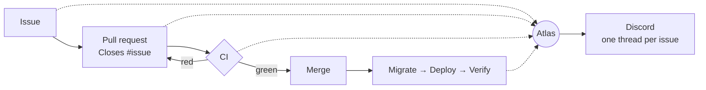

  

  <b>We build products, the platforms under them, and the agents that run them.</b> 
  Small team · production-first · everything automated, tested and observable.

  
  
  
  
  
  
  

---

## ◆ What we do

- **Products** — consumer apps for iOS and Android, built mobile-first.
- **Platforms** — the APIs, data and realtime systems underneath them.
- **Agents** — automation that runs the work around the code: tracking, CI, deploys, uptime.

## ◆ How we build

- **Issue first.** Every change starts as an issue; every PR closes one.
- **Green or it doesn't ship.** Lint, typecheck, unit tests, migration dry-runs and smoke tests on every PR; end-to-end user-journey tests run nightly.
- **Deploys are boring.** Migrate → deploy → verify, in that order, from one pipeline.
- **Everything reports in.** Issues, PRs, CI, deploys, errors and uptime land in one place, automatically.

## ◆ Working with us

Contribution guide, issue and PR templates and our code of conduct live in [this repository](https://github.com/Horizonwright/.github).
Found a security problem? Please report it privately — see [SECURITY.md](https://github.com/Horizonwright/.github/blob/main/SECURITY.md).

Horizonwright · est. 2026

